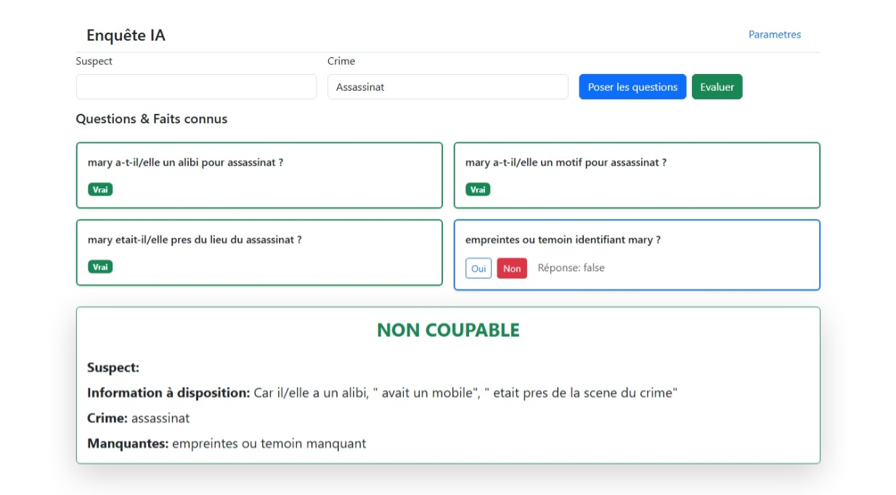

# Enquête policière (Projet IA)

**Projet basé sur la programmation logique (PROLOG)**: construction et optimisation d'une logique pour vérifier si un suspect est coupable ou non d'un crime à l'aide des informations déjà à disposition.


## Installation 📦
Il faut quelques pré-requis pour pouvoir installer et lancer l'application correctement:

1. Avoir "*SWI-Prolog*" installé sur sa machine.

2. AVoir le chemin d'accès au dossier des exécutables de SWI-Prolog (`/chemin/vers/swipl/bin`) dans la variable d'environnement `PATH` de votre système pour pouvoir l'utiliser à partir de n'importe quel dossier.

Puis:

- Cloner le depôt avec la commande suivante:

```bash
git clone https://github.com/Faniry05/Prolog-ia .
```

- Acceder au dossier `frontend` et installer les dépendances:

```bash
cd frontend
npm install 
```

- Et enfin, lancer l'application:

```bash
npm start
```

## Utilisation 💻

Sur l'interface de l'application, l'utilisateur est amené à saisir le nom du suspect et le type de crime dont on l'accuse (*Assassinat, vol, escroquerie*). Ensuite, en cliquant sur le bouton `Poser des questions`, il devra répondre aux questions en rapport avec les informations reçues concernant le suspect avant de valider en utilisant le bouton `Evaluer`.

**Resumé des actions** :

1. Saisir les informations (nom du suspect, type de crime)
2. Cliquer sur le bouton `Poser des questions`
3. Répondre aux questions concernant les faits
4. Valider en cliquant sur le bouton `Evaluer`

NB : Notez bien que certaines informations concernant les suspects comme '*Mary*', ou '*Alice*' sont déjà enregistrées dans le systèmes, et sont directement considérées comme '**connues**'.


## 📷 Aperçu




